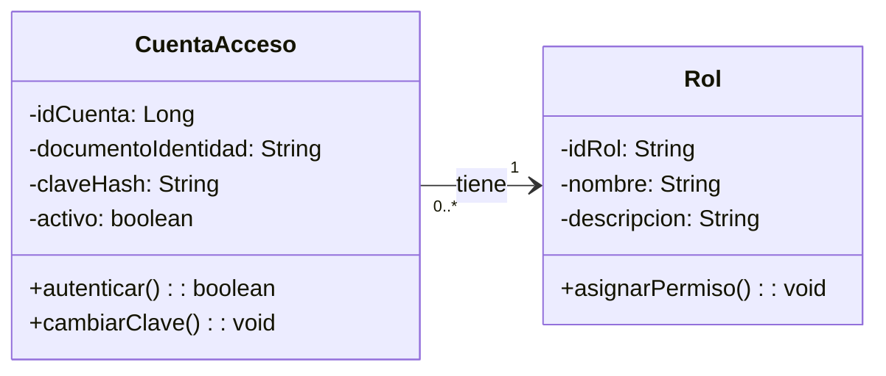
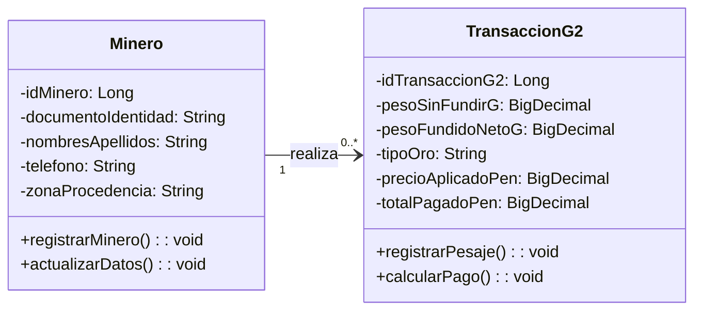
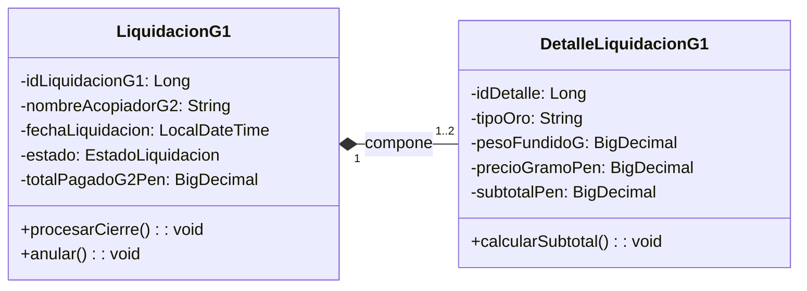
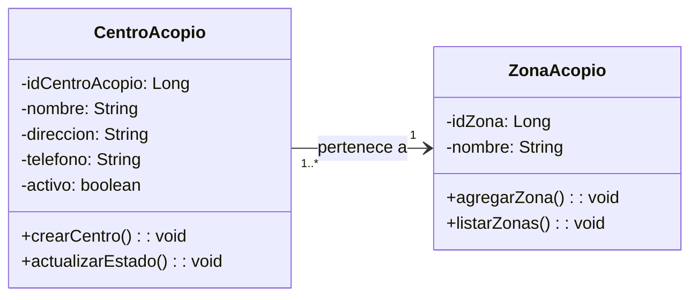
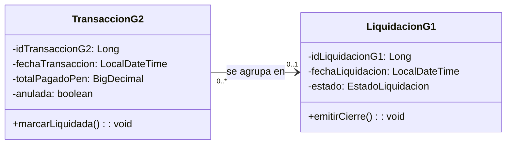

# SITRA-ORO · Análisis de Relaciones y Cardinalidades Binarias entre Clases
**Curso:** Análisis y Diseño de Sistemas (ADS)  
**Formato:** Pares de Clases con Lectura Bidireccional de Cardinalidades (Metodología del Docente)

---

## Par 1: `CuentaAcceso` ➔ `Rol` (Asociación Simple)

* **cuenta a rol:** Una cuenta de usuario debe pertenecer obligatoriamente a un solo rol (`MINERO`, `G2_ACOPIADOR` o `G1_MAYORISTA`).
* **rol a cuenta:** Un rol puede estar asignado a varios usuarios registrados en el sistema.

---

## Par 2: `Minero` ➔ `TransaccionG2` (Asociación Uno a Muchos)

* **minero a transaccion:** Un minero puede realizar de cero a muchas compras/ventas de oro en el centro de acopio.
* **transaccion a minero:** Una transacción de compra debe pertenecer obligatoriamente a un solo minero identificado.

---

## Par 3: `LiquidacionG1` ➔ `DetalleLiquidacionG1` (Composición Fuerte)

* **liquidacion a detalle:** Una liquidación mayorista contiene de 1 a 2 detalles consolidados (uno para oro ROJO y/o uno para oro VERDE).
* **detalle a liquidacion:** Un detalle de liquidación pertenece exclusivamente a una sola liquidación cabecera y no puede existir sin ella.

---

## Par 4: `CentroAcopio` ➔ `ZonaAcopio` (Clasificación por Región)

* **centro a zona:** Un centro de acopio físico pertenece obligatoriamente a una sola zona geográfica (La Rinconada, Ananea o Lunar de Oro).
* **zona a centro:** Una zona geográfica puede albergar uno o varios centros de acopio autorizados.

---

## Par 5: `TransaccionG2` ➔ `LiquidacionG1` (Asociación Débil / Agrupación de Cierre)

* **transaccion a liquidacion:** Una transacción de compra nace libre (`0`) y luego se agrupa en a lo sumo una liquidación mayorista (`1`).
* **liquidacion a transaccion:** Una liquidación mayorista agrupa muchas compras de oro emitidas por el acopiador (`0..*`).
