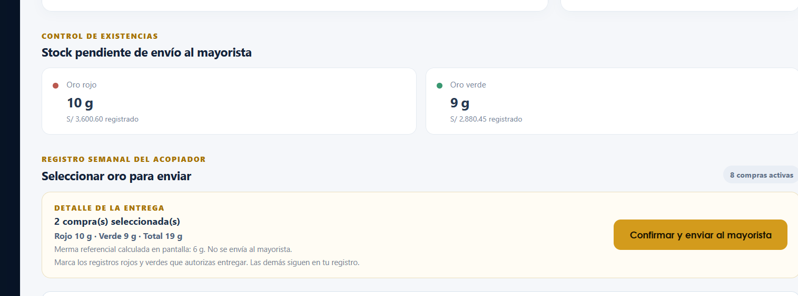
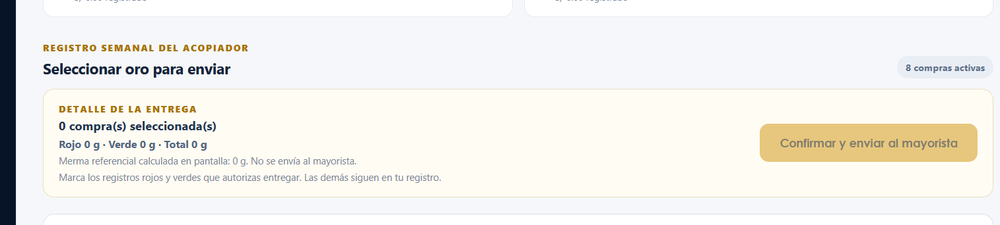
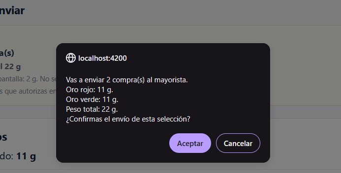
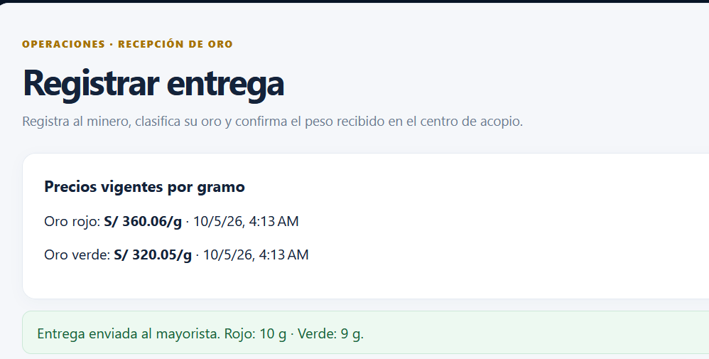
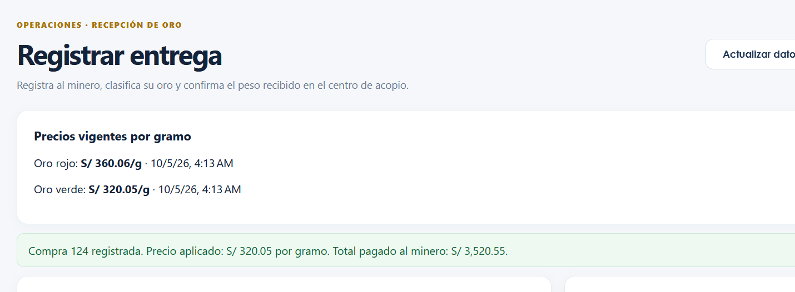
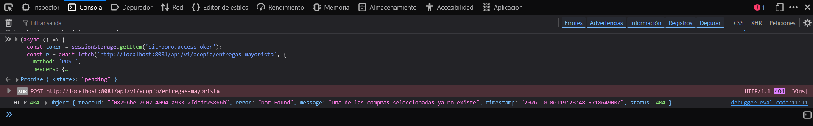
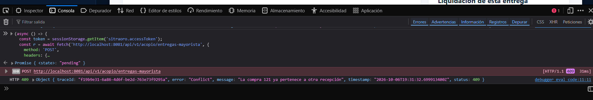
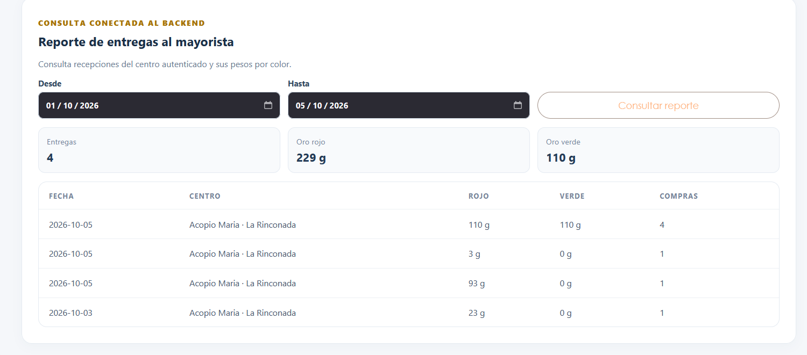

# Informe de evidencia de aprendizaje — S09

## Formularios transaccionales cabecera-detalle en SITRA-ORO

**Universidad Peruana Unión** · Escuela Profesional de Ingeniería de Sistemas  
**Asignatura:** Lenguaje de Programación II · Ciclo IV · 2026-II  
**Estudiante:** Faijo Calisaya Helio Paul  
**Equipo:** 05 · SITRA-ORO  
**Sesión:** S09 — Formularios Transaccionales Cabecera-Detalle  
**Rol o aporte:** Flujo del acopiador: selección de compras, envío al mayorista y consulta de entregas  
**Repositorio:** [SITRA-ORO](https://github.com/helionelio900-hub/SysProyec_Acopus)

> Este Markdown es el borrador del informe. La entrega final solicitada es un PDF con nombre `S09_LP2_Equipo05_CalisayaHelioPaul.pdf`. Las imágenes actualmente enlazadas son evidencia parcial; se deben reemplazar por capturas completas tomadas durante la ejecución real, sin recortarlas.

> **Estado:** el formulario organiza registro, preparación de entrega, historial y reporte en secciones. Las capturas parciales deben reemplazarse por evidencia completa con reloj y perfil visibles; también falta revisar la reflexión y exportar el PDF.

## 1. Operación elegida y modelos

La operación elegida es **enviar al mayorista una selección de compras ya registradas por el acopiador**. El acopiador decide qué compras entrega; cada compra conserva su minero, color y pesos. El backend crea una recepción como cabecera y vincula las compras escogidas como líneas del detalle. Las compras que no se seleccionan siguen en el registro del acopiador.

### DTO de solicitud real

El formulario no manda precios ni subtotales. Envía los identificadores de las compras que el acopiador decidió entregar:

```json
{
  "idsComprasAcopiador": [101, 104]
}
```

El DTO real es `EntregaMayoristaRequest(List<@NotNull @Positive Long> idsComprasAcopiador)`. `@Size(min = 1, max = 200)` limita la colección; cada elemento debe existir, ser positivo y no nulo. El servicio verifica duplicados, pertenencia al centro autenticado, vigencia y disponibilidad antes de vincular las compras.

### DTO de respuesta real

El DTO real de salida tiene estos campos y tipos, tal como están declarados en Java:

```java
RecepcionMayoristaResponse(
    Long idRecepcion,
    LocalDate fecha,
    Long idCentroAcopio,
    String nombreAcopiador,
    FilaOro rojo,
    FilaOro verde,
    String descuento,
    String total,
    List<Long> idsComprasAcopiador
)

FilaOro(
    BigDecimal pesoSinFundirG,
    BigDecimal pesoFundidoG,
    String onza,
    String dolar,
    String exportacion,
    String pagoMaterial
)
```

Las compras existentes funcionan como líneas vinculadas; no se duplican sus registros ni se modifica el precio que el acopiador pagó al minero. La respuesta separa los datos de oro rojo y verde en `FilaOro`.

### Relación cabecera-detalle

| Elemento | Modelo en SITRA-ORO | Responsabilidad |
|---|---|---|
| Cabecera persistida | `RecepcionMayorista` | Identifica fecha y centro, y conserva los pesos agregados por color. |
| Líneas variables del formulario | `FormArray` de IDs de compra | Mantiene los IDs de las compras marcadas en las tablas. Los IDs no se duplican. |
| Detalle persistido | `TransaccionG2` existentes | Cada compra seleccionada queda vinculada a la cabecera por `idRecepcionMayorista`. |
| DTO de entrada | `EntregaMayoristaRequest` | Envía `idsComprasAcopiador`; el servidor valida y calcula los pesos. |
| DTO de salida | `RecepcionMayoristaResponse` | Devuelve la cabecera, los acumulados por color y los IDs vinculados. |

La sección Preparar entrega presenta tablas de compras disponibles con casillas. Cada compra seleccionada ocupa un control del `FormArray`; ese arreglo mantiene la selección que se enviará. El historial mantiene tablas separadas por color para consultar, editar o eliminar compras. El peso total por color y la merma referencial se calculan en la pantalla; no se envían como valores confiables. El backend vuelve a consultar las compras y copia el peso fundido del acopiador como peso sin fundir recibido por el mayorista. El peso original del minero permanece en la compra del acopiador.

**Selección dinámica:** las tablas de Preparar entrega muestran únicamente compras disponibles, separadas en oro rojo y verde. Marcar una casilla incluye la compra en el `FormArray`; desmarcarla la retira. “Agregar compra” abre el mismo formulario de registro de una compra nueva al minero (color, pesos y precio); al guardar, aparece en la tabla de disponibles para seleccionarla. El registro de una compra y su inclusión en una entrega son operaciones distintas. El panel duplicado de selectores fue retirado.

## 2. Evidencia técnica

### Estado frente a los criterios de S09

| Criterio | Estado actual | Qué falta para cerrar |
|---|---|---|
| FormArray dinámico con mínimo una compra | Implementado: selección de compras mediante casillas y colección validada de 1 a 200 IDs | Capturar compras incluidas y retiradas al marcar y desmarcar. El flujo actual no tiene botones independientes para agregar/quitar detalles. |
| Derivados y total con `computed` | Implementado: merma por compra, pesos rojo, verde y total, además de merma agregada | Tomar captura de filas completas y resumen reactivo visible. |
| Validación de colección y campos | Implementado: ID positivo por línea, colección no vacía, IDs únicos y límite 200 | Evidenciar colección vacía/botón deshabilitado y, si es posible, un duplicado rechazado sin enviar. |
| Confirmación y dos errores distintos | Diálogo previo y respuestas API 404/409 capturados | Si la rúbrica lo exige, capturar también los mensajes visibles de la interfaz para cada error. |
| Consulta de agregados con filtro | Captura real: 01/10/2026–05/10/2026, 4 entregas, 229 g rojos y 110 g verdes | Completar captura de pantalla completa con reloj y perfil visibles. |
| PDF y requisitos de evidencia | El Markdown y nueve capturas parciales están en GitHub; aún no hay PDF S09 | Sustituir evidencia por capturas completas, cotejar fechas con GitHub y exportar el PDF con el nombre exacto pedido. |

Cada captura final debe mostrar la pantalla completa, el reloj del sistema con fecha y hora y el usuario/perfil de Windows, VS Code o navegador. Guarda las capturas nuevas en `docs/img_S09_FaijoCalisayaHelioPaul/`; conserva los archivos actuales como evidencia parcial hasta reemplazarlos.

### Bloque 1 — Formulario con detalle dinámico

**Captura parcial disponible:** `captura-01-resumen-seleccion.png`.

**Evidencia real recibida — resumen de selección.** En el momento de esa captura estaban seleccionadas 2 compras: registro rojo #121 (10 g) y registro verde #122 (9 g), para un total de 19 g. La merma referencial mostrada era 6 g y no se envía al mayorista. Una captura posterior confirma que el usuario completó el envío de esas cantidades.


Esta imagen solo muestra el resumen de selección, no la pantalla completa ni el reloj y el perfil del sistema. Se conserva como evidencia complementaria; falta tomar la captura completa solicitada por la rúbrica.

**Explicación.** En Preparar entrega, el acopiador marca compras disponibles en las tablas por color. Cada fila identifica compra, minero y peso fundido. Marcar agrega el ID al detalle y desmarcar lo retira. La colección exige al menos una compra y no admite IDs duplicados. Agregar compra registra una compra nueva mediante el formulario existente.

**Qué falta capturar:** pantalla completa con compras reales marcadas en las tablas, resumen actualizado, perfil y reloj. La evidencia debe mostrar que la selección corresponde a los registros que se enviarán.

### Bloque 2 — Cálculos y validación

**Archivo:** `captura-02-calculos.png`



**Explicación.** Al seleccionar una compra, la pantalla del acopiador muestra el subtotal de peso fundido y calcula la merma referencial como peso sin fundir menos peso fundido. Un `computed` suma las mermas y los pesos fundidos rojos y verdes para obtener el total de la entrega. La merma queda solo en el acopiador; el backend vuelve a leer las compras y guarda en la recepción mayorista solo el peso fundido neto por color.

**Corrección de evidencia.** Esta imagen es igual a la captura 01; no constituye una captura independiente de los cálculos. El componente recalcula con `computed` los pesos por color, el total y la merma agregada cuando cambia la selección. Falta una captura completa con valores reales seleccionados, reloj y perfil visibles.

**Archivo:** `captura-03-validacion.png`



**Evidencia real recibida.** Con cero compras seleccionadas, la pantalla muestra 0 g por color y total, y deshabilita “Confirmar y enviar al mayorista”; así impide enviar una colección vacía. Esta captura es parcial y no incluye reloj ni perfil. El backend valida tamaño de 1 a 200 IDs positivos y el frontend evita duplicados; falta una captura completa que evidencie la validación.

### Bloque 3 — Confirmación y manejo de errores

**Archivos:** `captura-04-confirmacion.png`, `captura-05-error-404.png` y `captura-06-error-409.png`



**Evidencia real recibida.** El diálogo del navegador muestra 2 compras, 11 g de oro rojo, 11 g de oro verde y 22 g en total, y solicita confirmar antes de enviar. Esta selección corresponde a esta captura y es distinta de la selección anterior de 10 g rojos + 9 g verdes cuyo resultado exitoso se documenta debajo. La imagen no incluye reloj ni perfil del sistema.

**Explicación.** Antes del POST, el diálogo muestra cantidad de compras, gramos rojos, verdes y total. Si se cancela, no se envía la solicitud; si se confirma, el frontend manda únicamente la lista de IDs. Así el acopiador puede revisar la selección antes de crear la recepción.

**Resultado real del envío:** la captura posterior muestra el aviso verde “Entrega enviada al mayorista” con rojo 10 g y verde 9 g. Esto documenta que la operación sí se confirmó.



**Evidencia complementaria — registro de compra #124.** La segunda imagen recibida documenta otro evento: el sistema informa que registró la compra 124, con precio aplicado de S/ 320.05 por gramo y total pagado de S/ 3,520.55. Se mantiene separada del diálogo de envío al mayorista.





**Evidencia real recibida.** Se envió al endpoint `POST /api/v1/acopio/entregas-mayorista` un ID positivo inexistente. El backend respondió HTTP 404 con el mensaje “Una de las compras seleccionadas ya no existe”. La prueba usa un ID ficticio y no edita compras reales; la excepción dentro de la operación transaccional hace que se revierta la recepción iniciada.

**Alcance de esta captura.** Muestra la respuesta del backend en la Consola de herramientas de desarrollo. No muestra un aviso emergente de la interfaz, porque la solicitud se hizo directamente desde Consola. El frontend traduce 404 a “Una compra seleccionada ya no existe. Actualiza el listado antes de enviar.”, pero todavía falta capturar ese aviso en pantalla si la rúbrica lo exige.



**Evidencia real recibida.** Se reenvió la compra #121, que ya pertenecía a una recepción. El backend respondió HTTP 409 Conflict con el mensaje “La compra 121 ya pertenece a otra recepción”. La excepción ocurre antes de modificar la compra y la operación transaccional revierte la nueva recepción iniciada; el envío anterior permanece intacto.

**Alcance de esta captura.** La respuesta se obtuvo desde Consola mediante una solicitud directa al endpoint. Muestra el conflicto real del backend, pero no un aviso emergente del frontend ni el reloj/perfil del sistema.

**Cómo obtener evidencia sin alterar compras reales:** el 404 usó un ID inexistente; el 409 reenvió la compra #121, que ya estaba vinculada. No se editaron ni eliminaron compras ni se cambió la recepción original. Las capturas de error obtenidas desde Consola muestran la respuesta real del backend; falta añadir capturas completas con reloj/perfil y los avisos del frontend si la rúbrica los exige.

## 3. Error o hallazgo técnico

Durante la integración, el envío devolvió HTTP 404 para `/api/v1/acopio/entregas-mayorista` porque la instancia del backend que estaba activa todavía no exponía la ruta que llamaba el frontend. Se revisó el controlador y el endpoint disponible, se alineó la llamada y se reinició el backend. Después se pudo completar el envío; el frontend distingue respuestas 400, 404 y 409 con mensajes específicos. La captura del 404 corresponde a la Consola y evidencia el diagnóstico del backend, no un aviso visual del formulario.

### Bloque 4 — Consulta o reporte

**Archivo:** `captura-07-reporte-con-filtro.png`



**Explicación.** El reporte consulta `GET /api/v1/acopio/entregas-mayorista/resumen` con fechas opcionales `desde` y `hasta`. El backend identifica el centro desde la sesión del acopiador, filtra las recepciones por fecha y devuelve cantidad de entregas, peso rojo, peso verde y filas de detalle. No acepta un ID de centro enviado por el navegador para decidir qué datos consultar.

**Evidencia real recibida.** Para el rango **01/10/2026–05/10/2026**, la pantalla muestra **4 entregas**, **229 g de oro rojo** y **110 g de oro verde**. Las cuatro filas son del centro “Acopio Maria · La Rinconada”: el 5 de octubre aparecen 110 g rojo/110 g verde (4 compras), 3 g/0 g (1 compra) y 93 g/0 g (1 compra); el 3 de octubre, 23 g/0 g (1 compra). Los valores por color coinciden con la suma de las filas.


La captura recibida no incluye el reloj ni el perfil del sistema; queda pendiente una captura completa para esos requisitos.

**Qué mostrar:** la captura completa con el filtro aplicado, agregados y filas recibidas del backend, reloj y perfil visibles; incluye Network si cabe sin ocultar esos datos.

## 4. Implementación y conexión

| Parte | Archivo o endpoint | Uso |
|---|---|---|
| FormArray, validación y cálculos | `lp2/sitra-oro-frontend/src/app/features/acopio/operaciones.ts` | Mantiene la colección de compras, evita duplicados y calcula subtotales con `computed`. |
| Controles y reporte | `lp2/sitra-oro-frontend/src/app/features/acopio/operaciones.html` | Presenta líneas dinámicas, confirmación, errores y reporte por fechas. |
| Servicio HTTP | `lp2/sitra-oro-frontend/src/app/core/api/operaciones.service.ts` | Envía IDs y consulta el reporte. |
| Crear recepción | `POST /api/v1/acopio/entregas-mayorista` | Crea cabecera y vincula las compras escogidas. |
| Consultar agregados | `GET /api/v1/acopio/entregas-mayorista/resumen?desde=AAAA-MM-DD&hasta=AAAA-MM-DD` | Devuelve agregados y detalle del centro autenticado. |
| Validación de negocio | `AcopiadorServiceImpl.vincularComprasRecepcion` | Comprueba disponibilidad y calcula pesos por color desde la base de datos. |

## 5. Reflexión técnica breve

**Borrador basado en el flujo implementado; revísalo y cámbialo para que refleje tu experiencia antes de entregar:**

En mi operación, lo más riesgoso sería enviar compras distintas de las que realmente quiero entregar al mayorista.
Eso podría pasar si selecciono una compra equivocada o no reviso el detalle antes de confirmar.
Una recepción incorrecta vincularía compras y pesos equivocados, y dificultaría rastrear el oro recibido.
El diálogo resume cuántas compras se enviarán y los gramos rojos, verdes y totales.
Antes de aceptar, revisaría las compras seleccionadas, su color, su peso y el centro de acopio.
Relaciono este control con Knight Capital porque una operación automática sin una barrera eficaz puede ejecutar acciones no deseadas.
Por eso valido la colección, calculo los totales y pido confirmación antes de enviar los identificadores al backend.

## 6. Preguntas de comprobación técnica

**¿Por qué el total se calcula con `computed`?** Porque depende de las compras seleccionadas y sus pesos; se recalcula cuando cambia esa selección, sin una llamada manual que pueda olvidarse o dejar el total desactualizado.

**¿Qué diferencia hay entre validar cada línea y validar la colección?** Cada línea exige un identificador positivo y no nulo. La colección exige de 1 a 200 compras y que no haya IDs repetidos; ambas validaciones protegen condiciones distintas.

**¿Qué muestra la confirmación?** La cantidad de compras seleccionadas y los pesos rojo, verde y total para que el acopiador pueda revisar el resumen antes del POST.

**¿Cómo distingue los mensajes de error?** El frontend revisa el estado HTTP: 400 indica una selección inválida, 404 una compra inexistente y 409 una compra no disponible o ya vinculada.

**¿Cómo se relaciona con Knight Capital?** Si una selección errónea se enviara automáticamente sin revisar el resumen, la recepción podría asociar compras y pesos equivocados. La validación y la confirmación son barreras antes de ejecutar esa operación.

## 7. Datos de la actividad

**Nombre:** Faijo Calisaya Helio Paul  
**Equipo:** 05  
**Sesión:** S09 — Formularios Transaccionales Cabecera-Detalle  
**Rol o aporte realizado:** Formulario dinámico de entrega del acopiador, validación, confirmación, manejo de errores y reporte filtrable.  
**Link de GitHub:** [SysProyec_Acopus](https://github.com/helionelio900-hub/SysProyec_Acopus)

