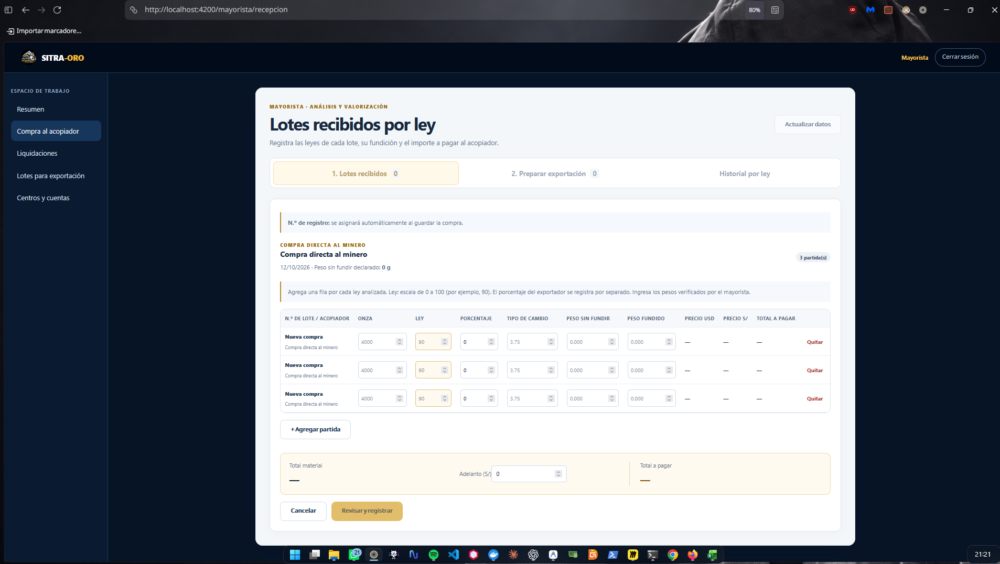
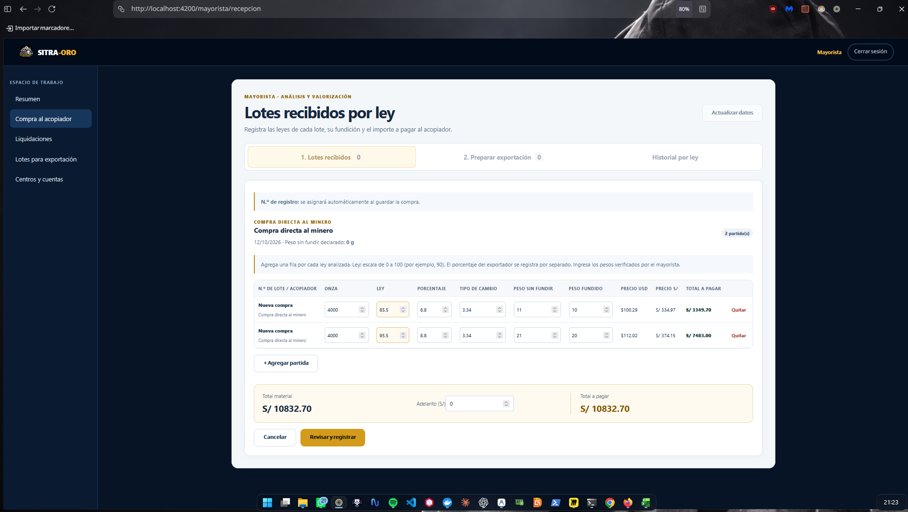
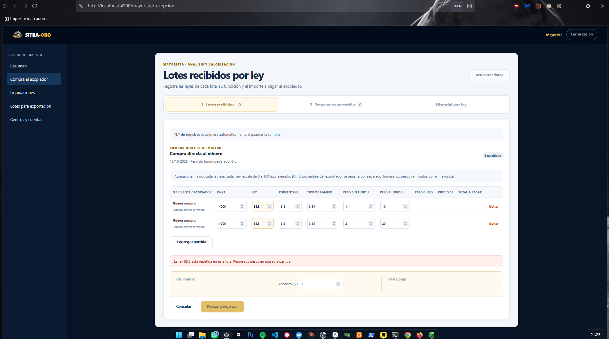
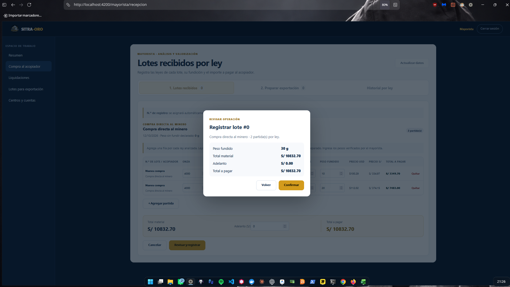
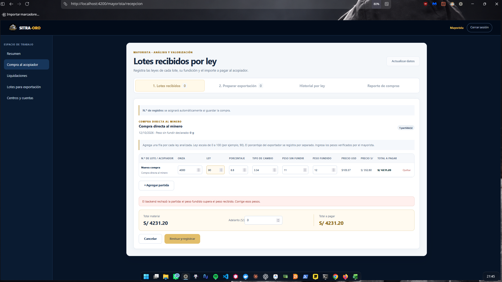
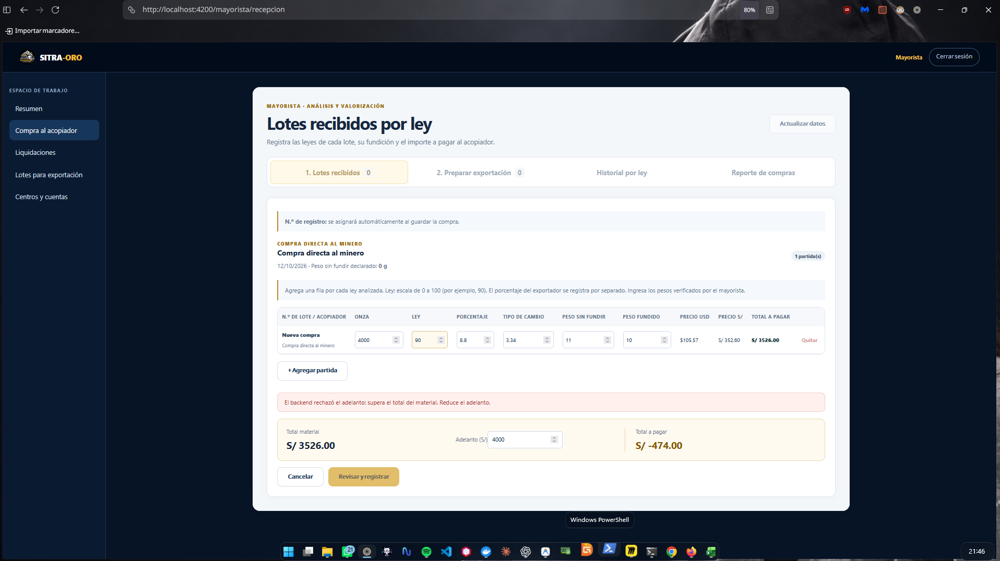
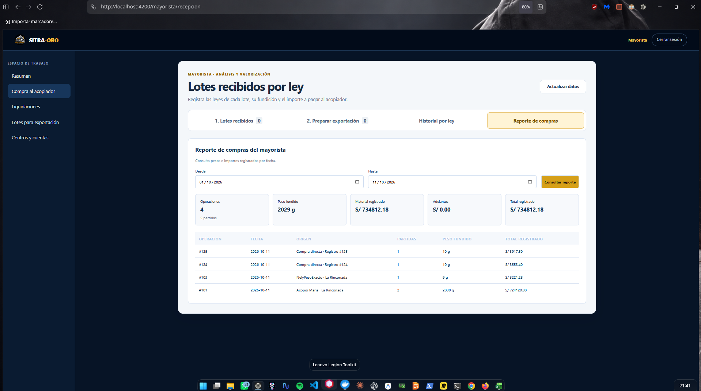
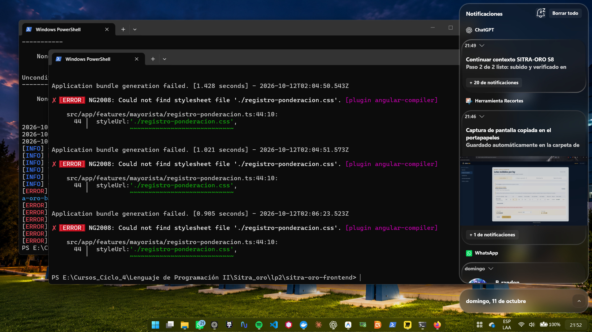

# Informe individual de aprendizaje — S09
## Formulario transaccional cabecera-detalle del módulo Mayorista de SITRA-ORO

**Nombre:** Faijo Calisaya Helio Paul  
**Equipo:** 05  
**Asignatura:** Lenguaje de Programación II  
**Sesión:** S09 — Formularios Transaccionales Cabecera-Detalle  
**Módulo:** Mayorista  
**Rol o aporte realizado:** Formulario de compra directa por partidas, cálculos reactivos, validación de colección, confirmación, manejo de errores y reporte de compras con filtros.  
**Repositorio:** [SysProyec_Acopus](https://github.com/helionelio900-hub/SysProyec_Acopus).


## 1. Operación elegida y modelos

La operación elegida es **registrar una compra directa de oro en Mayorista con varias partidas por ley**. La cabecera identifica la operación, la fecha y el adelanto; el detalle contiene las partidas de oro recibidas. Cada partida registra onza, ley, porcentaje, tipo de cambio, peso sin fundir y peso fundido. El sistema calcula el precio por gramo y el importe correspondiente. La compra directa se identifica mediante un número de registro generado al guardar y no solicita DNI, nombres ni clasificación por color.

El formulario corresponde al negocio de SITRA-ORO. No representa una venta de productos ni añade cantidades comerciales ajenas al sistema. El peso del oro y la ley son los datos centrales de cada partida.

| Elemento | Modelo real | Responsabilidad |
|---|---|---|
| Cabecera | `RecepcionMayorista` | Número de operación, fecha, origen de compra directa, revisión e importe registrado. |
| Detalle | `DetalleRecepcionLey` | Ley, parámetros de valorización, pesos, precios e importe por partida. |
| Catálogo compartido | `LeyOro` | Una misma ley puede participar en varias operaciones. |
| Entrada HTTP | `CompraDirectaMayoristaController.Compra` | Envuelve los datos del análisis enviados por el formulario. |
| Análisis de entrada | `RecepcionLeyRequest` | Revisión, adelanto y colección variable de partidas. |
| Respuesta | `RecepcionLeyResponse` | Operación registrada, detalles, pesos, subtotal, adelanto y total. |

### DTO real de entrada

El endpoint `POST /api/v1/mayorista/compras-directas` recibe este envoltorio:

```java
public record Compra(
    @NotNull @Valid RecepcionLeyRequest analisis
) {}
```

El análisis contiene:

```java
public record RecepcionLeyRequest(
    @NotNull @PositiveOrZero Long revision,
    @NotNull @DecimalMin("0")
    @Digits(integer = 18, fraction = 2) BigDecimal adelanto,
    @NotNull @Size(min = 1, max = 200)
    List<@NotNull @Valid Partida> detalles
) {}
```

Cada `Partida` contiene exactamente estos campos:

```java
BigDecimal onza;
BigDecimal ley;
BigDecimal porcentaje;
BigDecimal tipoCambio;
BigDecimal pesoSinFundirG;
BigDecimal pesoFundidoG;
```

El backend valida que onza, ley, tipo de cambio y pesos sean positivos; la ley no supere 100 y el porcentaje sea menor que 100. Los parámetros admiten hasta cuatro decimales y los pesos hasta tres. La colección contiene entre 1 y 200 partidas.

Ejemplo de estructura de solicitud; los datos son ilustrativos, no evidencia de una ejecución:

```json
{
  "analisis": {
    "revision": 0,
    "adelanto": 0,
    "detalles": [
      {
        "onza": 4000,
        "ley": 90.7,
        "porcentaje": 8.8,
        "tipoCambio": 3.34,
        "pesoSinFundirG": 12,
        "pesoFundidoG": 10
      }
    ]
  }
}
```

Los precios, los importes por partida y el total no se envían como campos editables. El backend los vuelve a calcular antes de persistir la cabecera y sus detalles dentro de una transacción.

## 2. Evidencia técnica

### Bloque 1. Formulario con detalle dinámico

La colección `form.controls.detalles` utiliza `FormArray`. Se inicia con una partida y permite añadir o quitar grupos de controles. La última partida no puede eliminarse y el formulario limita la colección a 200 líneas.

#### Captura 1 — Formulario con partidas dinámicas



**Explicación:** la pantalla de compra directa del Mayorista muestra tres partidas dentro de una misma operación. Cada fila contiene sus parámetros y pesos, y dispone del botón Quitar; debajo de la tabla aparece Agregar partida. Esta estructura corresponde al `FormArray` de detalles del formulario. Los campos pendientes mantienen deshabilitado Revisar y registrar. En la cabecera se identifica el perfil Mayorista y en la barra del sistema se observa la hora de captura.


**Código de respaldo (frontend, versión actual):** `lp2/sitra-oro-frontend/src/app/features/mayorista/recepcion-mayorista.ts:288`.

```typescript
  protected agregar(): void {
    if (this.partidas.length >= 200 || this.guardando()) return;
    const anterior = this.partidas.at(this.partidas.length - 1)?.getRawValue();
    this.partidas.push(this.nuevaFila(anterior ? {
      tipoOro: anterior.tipoOro === 'ROJO' ? 'VERDE' : 'ROJO',
      onza: anterior.onza ?? undefined,
      porcentaje: anterior.porcentaje ?? undefined,
      tipoCambio: anterior.tipoCambio ?? undefined,
    } : undefined));
  }
  protected quitar(i: number): void { if (this.partidas.length > 1 && !this.guardando()) this.partidas.removeAt(i); }
```

**Corroboración horaria:** el reloj de la captura muestra **21:21**. El log muestra GET /recepciones-ley a las 21:20:54.996, antes de la captura. Añadir y quitar filas es una acción local; no requiere una petición HTTP por cada botón.

```text
2026-10-11 21:20:54.996 [8f046909-eb04-4c50-97cb-4f3e64f68a72] INFO  p.e.u.s.filter.CorrelationIdFilter - HTTP GET /api/v1/mayorista/recepciones-ley status=200 duracionMs=136
```

### Bloque 2. Cálculos y validación

`calculo` utiliza `computed` sobre los valores del formulario. `form.valueChanges` actualiza el estado de las partidas y su validez. El precio, el importe de cada línea y el total se recalculan al cambiar una dependencia. El cálculo visual mantiene la fórmula comercial del backend; antes de permitir la confirmación, `calculoValidado` comprueba la coincidencia entre los importes calculados en ambos lados.


El cálculo visual utiliza enteros escalados (`BigInt`) para mantener el redondeo decimal utilizado por el servidor. Los valores almacenados siguen siendo determinados por el backend. El cambio no modifica la fórmula ni añade un porcentaje nuevo.

#### Captura 2 — Cálculos por partida y total



**Explicación:** el formulario presenta dos partidas con leyes distintas. La primera tiene ley 85.5, 11 g recibidos y 10 g fundidos; muestra un precio de S/ 334.97 por gramo y un importe de S/ 3349.70. La segunda tiene ley 95.5, 21 g recibidos y 20 g fundidos; muestra S/ 374.15 por gramo y un importe de S/ 7483.00. Ambas utilizan onza 4000, porcentaje 8.8 y tipo de cambio 3.34. El subtotal es S/ 10832.70; como el adelanto es cero, el total a pagar coincide con ese subtotal. El botón Revisar y registrar está habilitado. Frente a la captura anterior, la colección pasó de tres a dos partidas.


**Código de respaldo (frontend, versión actual):** `lp2/sitra-oro-frontend/src/app/features/mayorista/recepcion-mayorista.ts:90`.

```typescript
  private readonly valoresCalculo = signal(this.form.getRawValue());
  private readonly formularioValido = signal(false);
  protected readonly calculoValidado = computed(() => {
    const local = this.calculo(); const servidor = this.calculoServidor();
    return !!local && !!servidor && local.total === servidor.total && local.subtotal === servidor.subtotal
      && local.detalles.length === servidor.detalles.length && local.detalles.every((p,i) => p.precioPen === servidor.detalles[i].precioPen && p.totalPen === servidor.detalles[i].totalPen);
  });
  protected readonly calculo = computed<CalculoLey | null>(() => {
    const valores = this.valoresCalculo();
    if (!this.formularioValido()) return null;
    // Continúa el cálculo decimal exacto de precios e importes.
  });
```

**Corroboración horaria:** el reloj de la captura muestra **21:23**. Se registran cálculos HTTP 200 a las 21:23:26.733 y 21:23:27.259. Son del mismo minuto que el reloj visible. Los logs no contienen el cuerpo de la petición: no permiten vincular inequívocamente cada importe a un request.

```text
2026-10-11 21:23:26.733 [e3de1975-852a-4cd8-8c63-0bfa855769e5] INFO  p.e.u.s.filter.CorrelationIdFilter - HTTP POST /api/v1/mayorista/recepciones-ley/calcular status=200 duracionMs=63
2026-10-11 21:23:27.259 [bab71d4e-54e5-42ed-8344-fcdedf87840e] INFO  p.e.u.s.filter.CorrelationIdFilter - HTTP POST /api/v1/mayorista/recepciones-ley/calcular status=200 duracionMs=4
```

#### Captura 3 — Validación de la colección



**Explicación:** ambas partidas contienen la ley 85.5. La interfaz muestra el mensaje “La ley 85.5 está repetida en este lote. Reúne sus pesos en una sola partida”. Los precios e importes aparecen sin resultado y Revisar y registrar queda deshabilitado. La imagen demuestra que las partidas no pueden procesarse únicamente porque sus campos individuales tengan datos: también deben cumplir la regla de la colección. La captura muestra el rechazo visible, aunque por sí sola no identifica si el mensaje procede de la validación local o de una respuesta HTTP.


**Código de respaldo (backend, versión actual):** `lp2/sitra-oro-backend/src/main/java/pe/edu/upeu/sitraoro/acopio/mayorista/service/RecepcionLeyService.java:34`.

```java
            if (!vistas.add(idLey)) throw new MayoristaReglaException("LEY_REPETIDA", "La ley " + p.ley().stripTrailingZeros().toPlainString() + " está repetida en este lote. Reúne sus pesos en una sola partida.");
```

**Corroboración horaria:** el reloj de la captura muestra **21:25**. El backend registra a las 21:25:24.853 la excepción de ley 85.5 repetida y la respuesta HTTP 400. El texto coincide con el aviso de la imagen.

```text
2026-10-11 21:25:24.853 [2e9abb4d-d985-4554-a669-6d91e482653d] WARN  o.s.w.s.m.m.a.ExceptionHandlerExceptionResolver - Resolved [pe.edu.upeu.sitraoro.exception.MayoristaReglaException: La ley 85.5 está repetida en este lote. Reúne sus pesos en una sola partida.]
2026-10-11 21:25:24.853 [2e9abb4d-d985-4554-a669-6d91e482653d] INFO  p.e.u.s.filter.CorrelationIdFilter - HTTP POST /api/v1/mayorista/recepciones-ley/calcular status=400 duracionMs=17
```

### Bloque 3. Confirmación y manejo de errores

El botón Revisar y registrar abre un diálogo con la operación, sus partidas, leyes, pesos e importes. También muestra peso fundido total, subtotal, adelanto y total a pagar. La solicitud de guardado se ejecuta cuando el usuario confirma ese resumen y el cálculo visual coincide con el del servidor.

#### Captura 4 — Confirmación con resumen real



**Explicación:** antes de guardar, el diálogo presenta la compra directa con dos partidas y resume 30 g de peso fundido, S/ 10832.70 de material, S/ 0.00 de adelanto y S/ 10832.70 como total a pagar. Estas cantidades coinciden con las dos partidas de la captura 2. Los botones Volver y Confirmar permiten corregir los datos o autorizar el registro. El rótulo “Registrar lote #0” corresponde al identificador provisional de la nueva compra; el número definitivo se asigna al guardar.


**Código de respaldo (frontend, versión actual):** `lp2/sitra-oro-frontend/src/app/features/mayorista/recepcion-mayorista.ts:306`.

```typescript
  protected revisar(): void {
    this.form.markAllAsTouched();
    if (this.form.valid && this.calculoValidado() && !this.errorCalculo() && !this.calculando() && this.editando()) this.confirmacion.set('guardar');
  }
```

**Corroboración horaria:** el reloj de la captura muestra **21:26**. El backend confirma cálculos válidos a las 21:26:40.375 y 21:26:40.739. La imagen muestra el diálogo antes de confirmar; estas entradas no son prueba de guardado.

```text
2026-10-11 21:26:40.375 [0ffaebff-4896-43ee-9cfc-e3e6fa633ed1] INFO  p.e.u.s.filter.CorrelationIdFilter - HTTP POST /api/v1/mayorista/recepciones-ley/calcular status=200 duracionMs=5
2026-10-11 21:26:40.739 [79c21136-6fa2-4bb8-ab40-fa8060d9f2c9] INFO  p.e.u.s.filter.CorrelationIdFilter - HTTP POST /api/v1/mayorista/recepciones-ley/calcular status=200 duracionMs=2
```

El backend identifica las reglas rechazadas mediante códigos diferenciados:

| Código | Respuesta | Regla |
|---|---|---|
| `PESO_FUNDIDO_SUPERA_ENTRADA` | HTTP 400 | El fundido no puede superar el peso recibido. |
| `ADELANTO_SUPERA_TOTAL` | HTTP 400 | El adelanto no puede superar el subtotal del material. |
| `LEY_REPETIDA` | HTTP 400 | La misma ley debe reunirse en una partida. |

El frontend revisa `error.code` y presenta un mensaje específico. Estos errores pueden producirse en el endpoint de cálculo previo; son respuestas reales del backend de la misma operación y evitan llegar al guardado con datos inválidos.

#### Captura 5 — Rechazo del backend por peso fundido superior al recibido



**Explicación:** una partida con ley 90 registra 11 g sin fundir y 12 g fundidos. La interfaz mantiene la vista previa de los cálculos reactivos: precio S/ 352.60 por gramo e importe S/ 4231.20. Sin embargo, muestra “El backend rechazó la partida: el peso fundido supera el peso recibido. Corrige esos pesos” y deshabilita Revisar y registrar. Así se distingue entre calcular una vista previa y autorizar una operación válida. El frontend identifica el código `PESO_FUNDIDO_SUPERA_ENTRADA` de la respuesta del servidor y presenta el mensaje específico. En la imagen se observan el perfil Mayorista y la hora del sistema.


**Código de respaldo (backend, versión actual):** `lp2/sitra-oro-backend/src/main/java/pe/edu/upeu/sitraoro/acopio/mayorista/service/RecepcionLeyService.java:35`.

```java
            if (p.pesoFundidoG().compareTo(p.pesoSinFundirG()) > 0)
                throw new MayoristaReglaException("PESO_FUNDIDO_SUPERA_ENTRADA", "El peso fundido no puede superar el peso sin fundir");
```

**Corroboración horaria:** el reloj de la captura muestra **21:45**. A las 21:45:13.061 se registran la excepción de peso fundido superior al recibido y HTTP 400. Coinciden el minuto del reloj y la regla rechazada.

```text
2026-10-11 21:45:13.061 [ac03a27b-2121-4ba1-ba7f-fcafd0e9517d] WARN  o.s.w.s.m.m.a.ExceptionHandlerExceptionResolver - Resolved [pe.edu.upeu.sitraoro.exception.MayoristaReglaException: El peso fundido no puede superar el peso sin fundir]
2026-10-11 21:45:13.061 [ac03a27b-2121-4ba1-ba7f-fcafd0e9517d] INFO  p.e.u.s.filter.CorrelationIdFilter - HTTP POST /api/v1/mayorista/recepciones-ley/calcular status=400 duracionMs=39
```

#### Captura 6 — Rechazo del backend por adelanto superior al total



**Explicación:** la partida contiene ley 90, 11 g recibidos y 10 g fundidos, con importe de S/ 3526.00. El adelanto de S/ 4000 supera ese subtotal. La vista previa reactiva muestra S/ -474.00, pero el backend rechaza la operación y la interfaz indica “El backend rechazó el adelanto: supera el total del material. Reduce el adelanto”. Revisar y registrar permanece deshabilitado; el resultado negativo no se acepta como compra válida. El frontend distingue este caso mediante el código `ADELANTO_SUPERA_TOTAL`. La imagen incluye el perfil Mayorista y la hora del sistema.


**Código de respaldo (backend, versión actual):** `lp2/sitra-oro-backend/src/main/java/pe/edu/upeu/sitraoro/acopio/mayorista/service/RecepcionLeyService.java:50`.

```java
        if (request.adelanto().compareTo(subtotal) > 0) throw new MayoristaReglaException("ADELANTO_SUPERA_TOTAL", "El adelanto no puede superar el total de material");
```

**Corroboración horaria:** el reloj de la captura muestra **21:46**. A las 21:46:29.065 se registran la excepción de adelanto superior al material y HTTP 400. Coinciden el minuto del reloj y la regla rechazada.

```text
2026-10-11 21:46:29.065 [1e23b45a-adc7-48e4-ae13-6a83fd7c8878] WARN  o.s.w.s.m.m.a.ExceptionHandlerExceptionResolver - Resolved [pe.edu.upeu.sitraoro.exception.MayoristaReglaException: El adelanto no puede superar el total de material]
2026-10-11 21:46:29.065 [1e23b45a-adc7-48e4-ae13-6a83fd7c8878] INFO  p.e.u.s.filter.CorrelationIdFilter - HTTP POST /api/v1/mayorista/recepciones-ley/calcular status=400 duracionMs=2
```

### Bloque 4. Consulta o reporte

La pestaña Reporte de compras consulta un endpoint de agregados reales de Mayorista:

```http
GET /api/v1/mayorista/recepciones-ley/resumen?desde=AAAA-MM-DD&hasta=AAAA-MM-DD
```

El backend filtra por fecha las operaciones con partidas analizadas. Devuelve cantidad de operaciones, cantidad de partidas, peso fundido, subtotal, adelantos, total e ítems del reporte. Los acumulados proceden de los datos persistidos y son calculados en el backend; no son solo una suma de los controles del formulario.

#### Captura 7 — Reporte de compras filtrado por fechas



**Explicación:** se muestra el filtro Desde 01/10/2026 y Hasta 11/10/2026. El reporte presenta cuatro operaciones, cinco partidas, 2029 g de peso fundido, S/ 734812.18 de material registrado, adelantos de S/ 0.00 y un total registrado de S/ 734812.18. Las operaciones #125, #124 y #103 contienen una partida cada una, mientras que la #101 contiene dos. Sus pesos de 10, 10, 9 y 2000 g suman los 2029 g del agregado. Los importes S/ 3917.50, S/ 3553.40, S/ 3221.28 y S/ 724120.00 coinciden con el total del reporte. La vista consume el endpoint de resumen de Mayorista y muestra datos persistidos, incluidos registros directos y entregas de acopiadores.


**Código de respaldo (backend, versión actual):** `lp2/sitra-oro-backend/src/main/java/pe/edu/upeu/sitraoro/acopio/mayorista/service/RecepcionLeyService.java:64`.

```java
    @Transactional(readOnly=true)
    public ReporteCompras reporte(java.time.LocalDate desde, java.time.LocalDate hasta) {
        if(desde!=null && hasta!=null && desde.isAfter(hasta)) throw new IllegalArgumentException("La fecha inicial no puede superar la fecha final");
        var items=listar(null).stream().filter(r -> !r.detalles().isEmpty()
          && (desde==null || !r.fecha().isBefore(desde)) && (hasta==null || !r.fecha().isAfter(hasta))).toList();
        return new ReporteCompras(desde,hasta,items.size(),items.stream().mapToLong(r->r.detalles().size()).sum(),
          items.stream().map(RecepcionLeyResponse::pesoFundidoG).reduce(BigDecimal.ZERO,BigDecimal::add),
          items.stream().map(RecepcionLeyResponse::subtotal).reduce(BigDecimal.ZERO,BigDecimal::add),
          items.stream().map(RecepcionLeyResponse::adelanto).reduce(BigDecimal.ZERO,BigDecimal::add),
          items.stream().map(RecepcionLeyResponse::total).reduce(BigDecimal.ZERO,BigDecimal::add),items);
    }
```

**Corroboración horaria:** el reloj de la captura muestra **21:41**. El último GET /recepciones-ley/resumen anterior a la imagen consta a las 21:38:43.599, con HTTP 200. La captura a las 21:41 muestra el resultado ya cargado. El log no registra los parámetros de fechas; el rango se acredita visualmente en la imagen.

```text
2026-10-11 21:38:43.599 [66da92bc-cc46-4e46-9af1-b770c4e11d29] INFO  p.e.u.s.filter.CorrelationIdFilter - HTTP GET /api/v1/mayorista/recepciones-ley/resumen status=200 duracionMs=52
```

## 3. Error o hallazgo técnico

### Evidencia de sustentación: error de compilación y fecha del trabajo



**Explicación:** esta captura documenta un error real de integración del frontend. Angular muestra `NG2008: Could not find stylesheet file './registro-ponderacion.css'` y señala la referencia `styleUrl` en `registro-ponderacion.ts`. El compilador no podía localizar la hoja de estilos del componente de ponderación; por eso fallaba la generación del paquete. Para resolverlo se comprobó el archivo CSS y su referencia en la carpeta del componente, y se reinició el servidor de desarrollo para cargar la versión actual. El archivo está actualmente presente y versionado en el repositorio.

**Fecha y hora de la sustentación:** la imagen incluye el calendario de Windows con “domingo, 11 de octubre” y el reloj del sistema a las **21:52**. Los mensajes de compilación contienen fechas **2026-10-12T02:04:50Z**, **02:04:51Z** y **02:06:23Z**. La letra `Z` indica UTC: esas horas corresponden a las **21:04–21:06 del 11/10/2026 en Lima (UTC−05:00)**. Por tanto, que los logs indiquen el día 12 y el calendario local el día 11 es coherente con la diferencia horaria.

Esta imagen respalda el diagnóstico y aporta contexto temporal del trabajo. Es evidencia complementaria; no convierte las capturas anteriores sin fecha completa en imágenes que la muestren ni acredita por sí sola un usuario personal.

### Adecuación del formulario a S09

En la primera implementación, los importes se actualizaban mediante una llamada al endpoint de cálculo y quedaban en un `signal`. El formulario tenía cálculos automáticos, pero no acreditaba específicamente los derivados con `computed`. Se incorporó el estado reactivo del formulario y un `computed` para los precios por línea y el total, conservando las escalas y el redondeo del servidor.

También se incorporó Reporte de compras y el endpoint `/recepciones-ley/resumen`, porque el promedio de exportación no constituía una consulta de agregados con fechas. El backend sigue validando y recalculando antes de guardar; el formulario solo permite confirmar cuando el cálculo visual coincide con el del servidor.


### Corroboración temporal del backend y GitHub

Los extractos anteriores proceden del archivo real `lp2/sitra-oro-backend/logs/s09-mayorista-runtime.log`; se conserva una selección sin contraseñas ni tokens en `docs/evidencia_S09_Mayorista_backend.txt`. Las entradas corresponden al **11/10/2026**, según el backend. Los relojes de las imágenes muestran minutos de esa misma secuencia. Esta coincidencia respalda el contexto temporal, pero no equivale a que cada imagen muestre explícitamente la fecha completa.

Las capturas 1–4 corresponden a la interfaz anterior al reinicio de Angular de las 21:37. Por ello sus importes y confirmación se corroboran con el backend; el uso actual de `computed` se sustenta adicionalmente con el código publicado, sin atribuir esa implementación visual a una captura anterior. Las capturas 5–7 muestran la interfaz actualizada.

Git registra la publicación del informe y código en `0c85747` el **11/10/2026 a las 21:49:04 UTC−05:00**, y la evidencia complementaria en `5e6b9ae` a las **21:54:38** del mismo día. Son posteriores a las capturas correspondientes. El texto y las imágenes de este informe no se han modificado para fabricar fechas o identidad.

## 4. Reflexión técnica breve

El mayor riesgo sería registrar varias partidas con una ley o un peso incorrectos.
Esos datos determinan el precio por gramo y el importe que corresponde pagar.
Una operación con varias líneas podría multiplicar un error antes de que se advierta.
Por eso la confirmación debe mostrar las leyes, los pesos, el adelanto y el total real.
Relaciono esta revisión con Knight Capital por el riesgo de ejecutar acciones automáticas no deseadas.
La confirmación ayuda a revisar la intención, pero no sustituye las reglas del backend.
El recálculo y la transacción completan la protección de la compra registrada.
